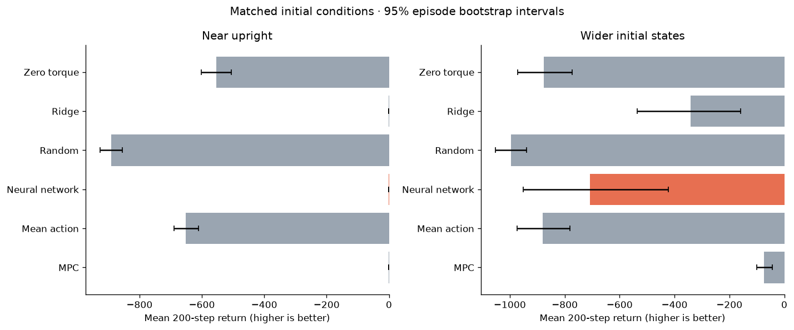
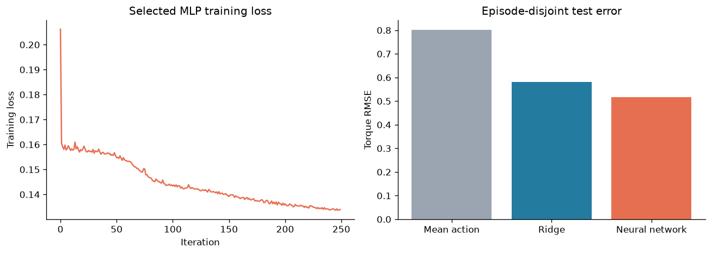
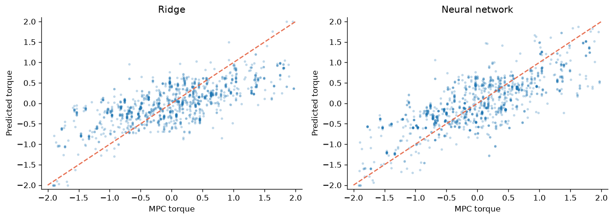
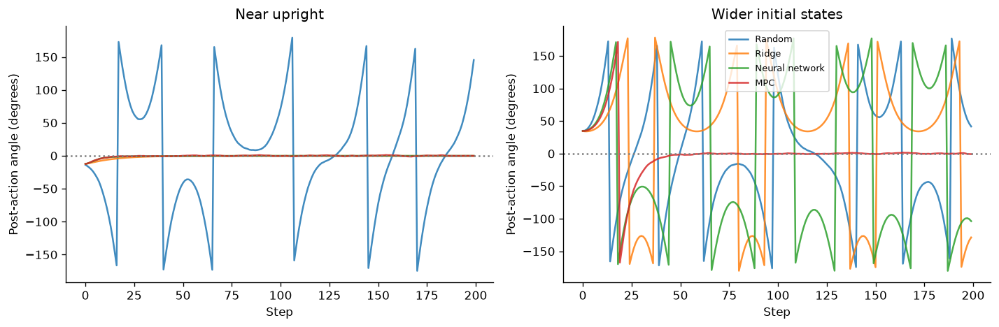
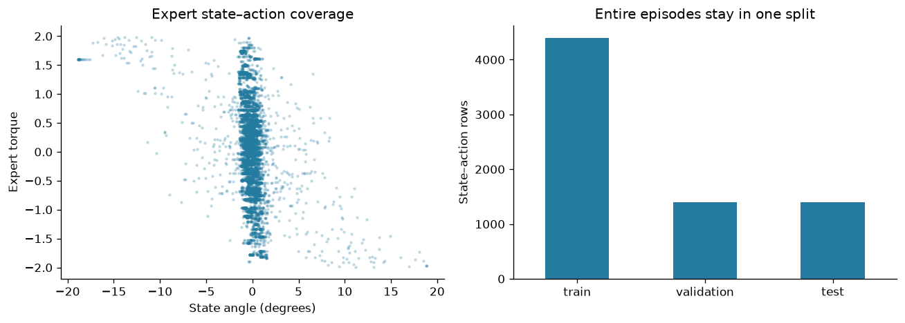
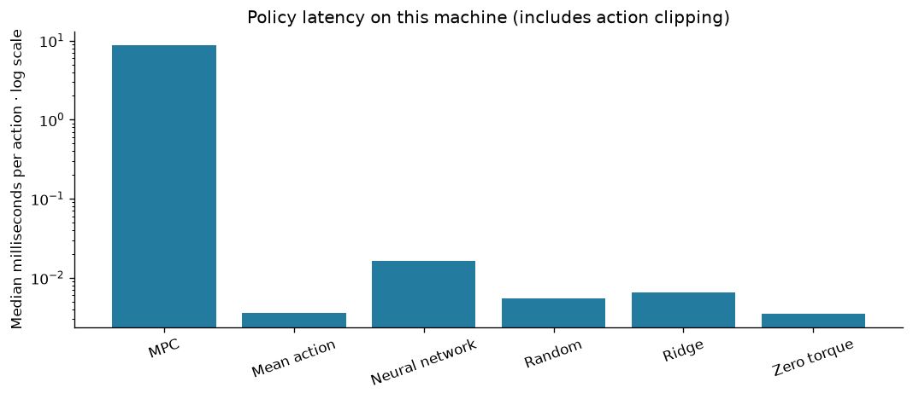

# Pendulum Control: Data Science, Optimization & Imitation Learning

**Can a neural network copy an MPC expert—and remain stable when it controls the system itself?**

This project turns a pendulum-control assignment into a reproducible data science experiment: generate demonstrations, prevent episode leakage, compare regression baselines, select a neural policy on validation data, and evaluate six controllers on matched simulation scenarios.

[Executed analysis notebook](pendulum_mpc_nn_portfolio_scipy.ipynb) · [Experiment implementation](src/experiment.py) · [Recorded results](results/) · [Validation tests](tests/test_validation.py)



## Skills demonstrated

| Area | Implemented evidence |
| --- | --- |
| Experiment design | Disjoint training/validation/test episodes; shared evaluation initial states and independent evaluation seeds |
| Data engineering | 7,200 expert state–action rows from 36 complete trajectories; reproducible episode-level split |
| Optimization | Bounded differential-evolution MPC with vectorized finite-horizon physics |
| Supervised learning | Mean-action and Ridge baselines; standardized MLP regression; validation-based architecture selection |
| Evaluation | MAE/RMSE/R², closed-loop return, upright fraction, torque, latency and paired bootstrap intervals |
| Software quality | Reusable module, pinned environment, numerical policy export and five meaningful validation tests |
| Communication | Executed notebook, generated figures, measured findings and explicit limitations |

## What changed from the original notebook

- Split **whole episodes** (22 train / 7 validation / 7 test), replacing random splitting of correlated time steps.
- Fit scalers only on training data and choose between two MLP architectures using validation RMSE.
- Retain all expert trajectories; avoid selecting only successful demonstrations.
- Evaluate Random, Zero torque, Mean action, Ridge, Neural network and MPC on **identical** initial states.
- Use the post-action state for final-angle and stability metrics.
- Validate the faster planning simulator against 100 random Gymnasium transitions/rewards.
- Save actual results, images, test predictions and deployable numerical weights.

The upgraded neural policy uses scikit-learn's MLPRegressor. The original PyTorch/skorch notebook is preserved as [historical source](docs/original_notebook.ipynb); it is not the validated workflow below.

## Verified results

Executed **28 October 2026** using Python 3.12.14. Selected neural architecture: **MLP 64x64**, based only on validation torque RMSE. The MLP reached its **250-iteration cap**; no optimizer-convergence claim is made.

### Offline imitation: untouched test episodes

| model | MAE | RMSE | R2 |
| --- | --- | --- | --- |
| Mean action | 0.639 | 0.802 | -0.000 |
| Ridge | 0.476 | 0.581 | 0.475 |
| Neural network | 0.417 | 0.518 | 0.583 |

Metrics use clipped torque predictions in [-2, 2]. Test rows come from seven episodes, not independent random observations. They measure imitation of an approximate expert, not optimal-control accuracy.





### Closed-loop control: separate evaluation scenarios

| scenario | controller | mean_score | upright_fraction |
| --- | --- | --- | --- |
| Near upright | MPC | -0.540 | 0.991 |
| Near upright | Mean action | -652.456 | 0.087 |
| Near upright | Neural network | -0.260 | 0.991 |
| Near upright | Random | -890.262 | 0.035 |
| Near upright | Ridge | -0.261 | 0.992 |
| Near upright | Zero torque | -552.812 | 0.205 |
| Wider initial states | MPC | -74.526 | 0.896 |
| Wider initial states | Mean action | -880.338 | 0.045 |
| Wider initial states | Neural network | -707.942 | 0.393 |
| Wider initial states | Random | -995.732 | 0.014 |
| Wider initial states | Ridge | -340.705 | 0.645 |
| Wider initial states | Zero torque | -875.482 | 0.032 |

Higher return is better; zero is the theoretical upper bound. Each controller runs 200 steps on the same **20 initial states per scenario**. Upright fraction requires |angle|<10° and |angular velocity|<0.5 rad/s after the action. Full confidence intervals are in [controller_summary.csv](results/controller_summary.csv); [paired_differences.csv](results/paired_differences.csv) reports neural-policy minus baseline differences with paired 95% bootstrap intervals.

**What the results show:** the MLP improves offline RMSE over Ridge (0.518 versus 0.581), but their near-upright closed-loop returns are almost equal. Neural minus Ridge return is 0.0009, with a paired 95% interval [-0.0204, 0.0219]. This experiment does not establish a neural-policy advantage there.

On wider initial states, mean return is **-707.94 for the neural network, -340.71 for Ridge and -74.53 for MPC**. Neural minus Ridge is -367.24, with a paired 95% interval [-577.94, -167.09]. The simpler baseline generalizes better to these scenarios despite its higher offline imitation error. MPC is strongest on the wider-state evaluation, at greater computational cost.

Offline action accuracy and closed-loop return answer different questions. Feedback can move the learned policy into states poorly represented in the demonstrations; the wider-state results expose that limitation rather than establishing general swing-up ability.



## Data and evaluation design

Training initial conditions: ±20° and ±0.1 rad/s. All 36 expert trajectories are retained, giving 7,200 state/action rows. Model inputs are cos(angle), sin(angle) and angular velocity; the target is MPC torque. The MLP candidates have tanh hidden layers of 32×32 and 64×64 units, alpha=0.01 and Adam learning rate=0.001. Validation selects the architecture; there is no test-driven tuning or refit on the test split.

MPC uses a 16-step horizon, 10 differential-evolution iterations and population multiplier 5. The planning dynamics match Gymnasium's configured gravity 9.81, time step 0.05, mass/length 1, speed limit 8 and torque limit 2. The optimizer has a fixed stochastic seed and budget; it is an approximate expert, not a proven global optimum.



The evaluation set has 20 near-upright states and 20 wider states (±90°, ±1 rad/s), with seeds distinct from the demonstrations. Bootstrap intervals use 2,000 episode resamples. They describe variation over initial conditions conditional on one trained policy, not uncertainty across training runs.

## Reproduce

From the repository root, using Python 3.12:

```bash
python -m venv .venv
# Activate .venv using your platform's activation command.
python -m pip install -r requirements.txt
python -m src.experiment
python -m unittest discover -s tests -v
```

The experiment regenerates every table, figure and policy weight file in `results/` and `images/`. CPU runtime depends on hardware; MPC demonstrations and evaluation are the expensive stages. Random seeds and versions are recorded in [run_manifest.json](results/run_manifest.json). Latencies and small numerical details may vary between runs and machines.

To explore the recorded run, install JupyterLab (`python -m pip install jupyterlab`), then run `jupyter lab pendulum_mpc_nn_portfolio_scipy.ipynb` **from the repository root**. The notebook executes checks and displays the saved experiment artifacts; run the experiment command first when regenerating training/evaluation data. It contains 6 executed analysis cells with saved outputs.

## Saved artifacts

| Path | Contents |
| --- | --- |
| `src/experiment.py` | Simulator, MPC, dataset generation, model fitting, evaluation and plotting |
| `results/demonstrations.csv` | Expert states/actions with episode and split identifiers |
| `results/validation.csv` | Validation scores used for MLP architecture selection |
| `results/regression_metrics.csv` | Train, validation and test metrics for each regressor |
| `results/test_predictions.csv` | Actual and predicted torques for independent metric recomputation |
| `results/controller_episodes.csv` | Every controller/scenario/episode result and starting condition |
| `results/controller_summary.csv`, `paired_differences.csv` | Aggregate scores and bootstrap intervals |
| `results/example_trajectories.csv` | One preselected episode per scenario, for illustration |
| `results/policy_weights.npz` | Selected neural weights, biases and scaler parameters; load with `allow_pickle=False` |
| `images/` | Six real experiment figures used in this README and notebook |
| `tests/test_validation.py` | Physics parity, episode separation, metric reconciliation, paired scenarios and saved-policy parity |

## Limits and next steps

This is simulated **near-upright stabilization**, not a validated general swing-up or hardware controller. There is one demonstration/training seed, seven held-out demonstration episodes and a small evaluation sample. MLP candidates hit their iteration cap. No sensor noise, actuator delay, domain randomization, structural mismatch or deployment-safety evaluation is included.



Latency is measured on this machine, without a warm-up protocol; it does not establish real-time guarantees. Fast inference alone does not establish control quality. Next experiments should repeat training seeds, compare MPC optimization budgets, test model mismatch/noise, and collect on-policy expert labels to address distribution shift.

Created by **Meroe Asgharbeigi**.
